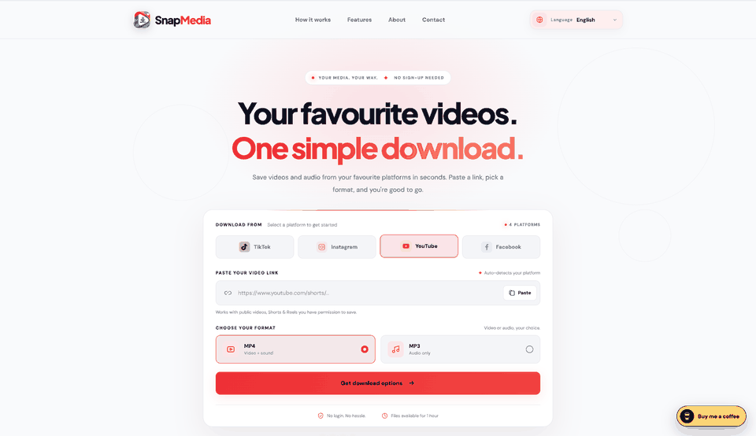

# SnapMedia



SnapMedia helps you save public videos from **TikTok, Instagram, YouTube, and Facebook** as MP4 video or MP3 audio. Paste a link, choose a format and quality, and download the finished file. Use it only for content you own or have permission to save; availability depends on the source platform.

## What it offers

- **One place for four platforms:** SnapMedia recognizes the platform from the link and adjusts the interface automatically.
- **Video or audio:** Choose MP4 with sound or MP3 audio, with standard and HD options where the source supports them.
- **Playable MP4 files:** Video is normalized to H.264 with AAC audio and checked for a decodable frame before download.
- **A comfortable interface:** Responsive layout, a one-tap link clear button, and 12 languages, including Italian and right-to-left Arabic.
- **No account required:** Prepared files are temporary and expire after about one hour.

The site uses a Flask backend, yt-dlp, and FFmpeg to prepare real downloads. It does not include simulated download buttons or advertising prompts.

## Try it locally

You'll need **Python 3.11+**, **FFmpeg** with `ffprobe` and the `libx264` encoder, and **Node.js 22+** for full YouTube extraction support.

On macOS with Homebrew:

```bash
brew install python ffmpeg node
./start-mac.sh
```

Or install the requirements and start the app yourself:

```bash
python3 -m venv .venv
source .venv/bin/activate
python -m pip install -r requirements.txt
python app.py
```

Open **http://127.0.0.1:5000**. If port 5000 is in use, start with `PORT=5001 python app.py` and open the matching address.

To save a file, paste a public video link, choose **MP4** or **MP3**, select **Get download options**, then choose **Download** or **Download HD**. Long videos that need conversion can take several minutes.

## Policies and privacy choices

The running site includes `/terms`, `/privacy`, `/copyright`, `/cookies`, and `/contact`. The footer's **Privacy choices** control lets visitors review or change optional preferences. Advertising and analytics are currently off; the labeled ad spaces are inactive placeholders. The policies still need the final operator, hosting, and log details before public launch.

## Project structure

This tree lists the files tracked in the project. Generated downloads, the local virtual environment, and cache files are ignored by Git.

```text
SnapMedia/
├── .env.example                   Example environment settings
├── .gitignore                     Local and generated files excluded from Git
├── README.md                      Project overview and local setup
├── app.py                         Flask server, routes, and media preparation
├── requirements.txt               Python packages needed to run the app
├── requirements-dev.txt           Python packages for tests and audits
├── start-mac.sh                   macOS local startup script
├── docs/
│   ├── ads.txt.example            Example publisher authorization file
│   ├── adsense-readiness.md        Advertising readiness notes
│   ├── assets/
│   │   └── snapmedia-demo.gif      Website walkthrough shown above
│   ├── launch-readiness.md         Prelaunch checklist
│   └── production-audit.md        Production review and open risks
├── instance/
│   └── downloads/
│       └── .gitkeep                Keeps the temporary download folder in Git
├── tests/
│   └── test_app.py                 Backend and route regression tests
└── web/
    ├── ads-config.js              Settings for inactive ad spaces
    ├── ads-placeholders.css        Ad space styling
    ├── ads-placeholders.js         Ad space behavior
    ├── app.js                      Downloader interface and interactions
    ├── config.js                   Public site configuration
    ├── contact.html                Contact page
    ├── cookies.html                Cookie Policy page
    ├── copyright.html              Copyright Policy page
    ├── favicon.svg                 Browser tab icon
    ├── i18n.js                     Interface translations
    ├── index.html                  Main website page
    ├── legal.js                    Legal page translations and content
    ├── privacy-controls.css        Privacy controls styling
    ├── privacy-controls.js         Cookie consent and privacy choices
    ├── privacy.html                 Privacy Policy page
    ├── snapmedia-logo.png          Main logo image
    ├── snapmedia-logo.webp         Optimized main logo image
    ├── styles.css                  Main website styling
    └── terms.html                  Terms of Use page
```

## Verify changes

```bash
python -m pip install -r requirements-dev.txt
python -m pytest -q
python -m pip_audit --local
```

The tests cover URL validation, page routes, SEO output, request limits, and MP4 conversion. For a real-world check, also try a current permitted link from each platform; their formats and access rules can change.

## Contact

Questions or feedback? Email [ahmed.alhennawi9@gmail.com](mailto:ahmed.alhennawi9@gmail.com). If SnapMedia helps you, you can [buy me a coffee](https://buymeacoffee.com/ahmed_alhennawi). Support is optional.
